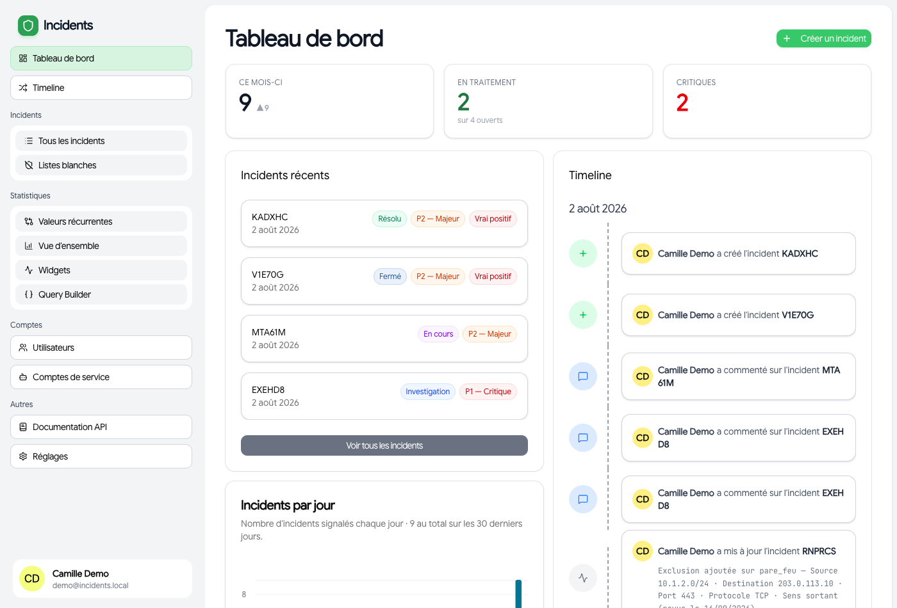

# Slowpoke

**Gestion d'incidents de cybersécurité** pour une équipe qui en traite au quotidien :
déclarer, suivre, qualifier et clôturer des incidents, dérouler la procédure qui s'y applique,
trier ce que remonte la détection, et rendre compte.

> **Fait par la cellule cyber de l'UMLP, pour la cellule cyber de l'UMLP.**
> Conçu, développé et utilisé en production par la cellule cyber de l'Université Marie et
> Louis Pasteur (UMLP) pour ses propres besoins, puis publié sous licence MIT pour que
> d'autres équipes puissent le reprendre, l'adapter et le déployer chez elles.

Merci à **Maxence**, principal contributeur au code.



## Ce que fait l'outil

- **Incidents** par type — hameçonnage, maliciel, rançongiciel, déni de service, intrusion,
  fuite de données, autre — avec les champs techniques propres à chacun, une chronologie, des
  pièces jointes et un pilote explicitement désigné.
- **Conduite à tenir** : la checklist de vos propres procédures, lue depuis un dépôt Git, avec
  l'avancement partagé entre analystes et les **échéances réglementaires** (NIS 2, RGPD,
  signalement au CERT) comptées depuis la date de connaissance — chacune déclarée applicable
  ou non, avec son auteur.
- **File d'alertes** : le triage de ce que produit la détection, à côté du registre. Une alerte
  n'est pas un incident ; seul ce qu'un humain décide d'escalader devient une fiche.
- **Listes blanches** : l'inventaire des angles morts volontaires, avec motif et date de revue
  obligatoires, rappelés à l'échéance et rapprochés des règles réellement posées dans l'EDR.
- **Enquête guidée** : les cases de la checklist qui peuvent être outillées le sont — valeurs
  déjà connues, état d'un compte dans l'annuaire, journaux d'authentification — toujours en
  lecture seule, avec un verdict rendu par un humain.
- **Statistiques** : volumes, délais, répartitions, tableau de bord de widgets, et un query
  builder SQL en lecture seule.
- **Notifications** Web Push multi-navigateurs et **webhooks** sortants signés.
- **Assistance par un modèle local**, facultative : résumés, indicateurs relevés, avis sur une
  alerte. Elle **n'écrit jamais dans un dossier** et ne décide rien — ses sorties sont stockées
  à part, avec le modèle et la version du prompt qui les ont produites.
- **Comptes de service** à portées opposables, pour alimenter l'outil depuis un orchestrateur.

Ce que l'outil n'est pas : un SIEM. Pas de recherche plein texte, pas de corrélation, pas de
rejeu — pour l'investigation, on pivote vers l'outil de détection.

## Pile technique

Monorepo **Turborepo**, géré avec **Bun 1.3**.

| Partie | Technologie | Emplacement |
|---|---|---|
| Interface | Nuxt 4 + Tailwind CSS | `apps/app` |
| API | ElysiaJS sur Bun, typée de bout en bout via Eden Treaty | `apps/server` |
| Base | PostgreSQL 18 + Drizzle ORM | `packages/database` |
| Authentification | Better Auth — SSO OIDC, mot de passe de secours, comptes de service | `packages/auth` |
| Sorties réseau | point de sortie unique, tracé | `packages/connecteurs` |
| Composants | bibliothèque partagée | `packages/ui` |

## Démarrer

```bash
bun install
bun run dev          # interface + API
bun run lint
bun run typecheck
```

Déploiement en production par **Docker Compose** :

```bash
cp .env.example .env     # puis renseigner les variables
docker compose up -d --build
docker compose run --rm server /app/migrate
```

Les migrations ne sont **pas** jouées au démarrage : c'est une commande à part, à lancer après
chaque mise à jour qui en ajoute. Le détail est dans
[`doc/Exploitation-MCO.md`](doc/Exploitation-MCO.md).

### À configurer avant usage

- **SSO OIDC** — `OIDC_*` dans `.env` ; sans lui, seule la connexion par mot de passe de
  secours fonctionne.
- **Votre organisation** — `packages/database/src/organisation.ts` est livré **vide** : il
  porte les composantes, les entités d'inventaire et les sigles de laboratoires de votre
  établissement. Sans lui, les statistiques par composante comptent tout en « sans
  composante », ce qui s'affiche tel quel plutôt que d'être deviné.
- **Les connecteurs**, tous facultatifs et tous réglables depuis l'interface par un
  administrateur, sans accès au serveur : dépôt de procédures (GitLab), inventaire (GLPI),
  EDR (HarfangLab), annuaire (LDAP), archives de journaux (Wazuh), tickets d'un SOC externe
  (API Advens), modèle d'assistance (serveur d'inférence compatible OpenAI).

## Documentation

| Document | Pour qui |
|---|---|
| [`doc/Guide-Utilisateur.md`](doc/Guide-Utilisateur.md) | Utilisateurs — rôles, incidents, alertes, listes blanches, statistiques |
| [`doc/Installation-Reglages.md`](doc/Installation-Reglages.md) | Administrateurs — réglages dans l'interface, installation Docker Compose |
| [`doc/Exploitation-MCO.md`](doc/Exploitation-MCO.md) | Exploitation — déploiement, migrations, sauvegardes, supervision, dépannage |
| [`doc/Documentation.md`](doc/Documentation.md) | Technique — architecture, API, charges utiles par type d'incident |

L'API est auto-documentée en **OpenAPI** et servie à `/openapi`.
Pour l'alimenter depuis un orchestrateur (n8n, Node-RED, un script), voir
[Automatiser la création d'incidents](doc/Documentation.md#automatiser-la-création-dincidents).

## Contribuer

Les conventions, le modèle de rôles et les règles d'écriture sont dans
[`CONTRIBUTING.md`](CONTRIBUTING.md). Les contributions passent par une *pull request* : `lint`,
`typecheck` et une recherche de secrets tournent automatiquement.

## Licence et provenance

[MIT](LICENSE) — © 2026 Université Marie et Louis Pasteur.

L'interface et la documentation sont **en français**, langue de travail de l'équipe qui
l'utilise.

Un des outils de la **cellule cyber de l'UMLP**, écrits pour ses propres besoins et
publiés ensemble :

| Outil | Rôle |
|---|---|
| **Slowpoke** (ce dépôt) | gestion des incidents de cybersécurité |
| **Catalogue** | cartographie du SI et conformité cyber |
| **Assistants IA** | réponses sourcées sur le corpus de procédures, analyse de journaux |
| **Astreintes** | planning et heures d'astreinte de l'équipe |
| **Arche** | réplique hors ligne et plan de reprise YunoHost + Docker |
| **Bureautix Fleet** | parc de postes de travail NixOS durcis, multi-entités |
