# Guide utilisateur — Slowpoke

**Slowpoke** (nom de code *Slowpoke*) est une application de **gestion d'incidents de cybersécurité** : déclarer, suivre, qualifier et clôturer les incidents de sécurité au quotidien, puis les visualiser en statistiques.

Ce guide s'adresse aux **utilisateurs** de l'application. Pour l'installation et les réglages, voir [`Installation-Reglages.md`](Installation-Reglages.md) ; pour l'exploitation, [`Exploitation-MCO.md`](Exploitation-MCO.md).

> Les captures proviennent d'une **instance de démonstration** : tous les noms, adresses, IP et domaines y sont **fictifs** (`example.org`, plages de documentation RFC 5737). La légende sous chaque image indique **ce qu'il faut y regarder**. Voir [`images/README.md`](images/README.md) pour la convention et la check-list d'anonymisation si vous en refaites depuis la production.

---

## 1. Se connecter

Sur la page de connexion, un seul bouton, dont le libellé est celui du fournisseur d'identité configuré (SSO OpenID Connect). Vous êtes redirigé vers ce fournisseur, puis ramené sur le tableau de bord.

Il n'y a pas de formulaire e-mail / mot de passe sur cette page : l'accès quotidien se fait par le SSO.

> **Si le SSO est en panne** — un lien discret en bas de la page mène à `/login-secours`, une connexion par e-mail et mot de passe réservée à ce cas. Elle sert à reprendre la main quand l'annuaire ne répond plus ; ses identifiants sont dans le coffre de l'équipe et **chaque usage est enregistré au journal d'audit**. En fonctionnement normal, passez par le SSO.

Une fois connecté, vous arrivez sur le **tableau de bord**.

>
> 📷 **Le tableau de bord (accueil).** En haut le bandeau de KPI, en dessous les incidents récents et l'activité. C'est la page qui répond à « qu'est-ce qui demande mon attention aujourd'hui ? » — le KPI **Critiques** passe en rouge dès qu'un incident critique est encore actif.

Au-dessus des compteurs d'incidents, une tuile **« Alertes à trier »** : ce qui attend une décision, combien d'alertes sont déjà prises, et **depuis combien de temps la plus ancienne attend**. Au-delà de 24 h sans rien reçu, elle demande si la source est encore branchée — une file calme et une remontée interrompue se ressemblent trop (voir [§2 bis](#2-bis-les-alertes--la-file-de-triage)).

---

## 2. Rôles : qui peut faire quoi

Votre **rôle** détermine ce que vous voyez et pouvez faire. Il y a quatre rôles applicatifs (plus les comptes de service pour les machines).

| Rôle | Comment on l'obtient | Ce qu'il permet |
|------|----------------------|-----------------|
| **user** | par défaut à la 1ʳᵉ connexion | Connecté mais **aucun accès** aux données tant qu'un admin ne vous attribue pas un rôle. |
| **lecteur** | attribué par un admin | **Lecture seule** : consulter les incidents et les statistiques. |
| **gestionnaire** | attribué par un admin | Lecture + **créer / modifier / supprimer** des incidents, gérer les utilisateurs concernés. |
| **admin** | automatique si membre du groupe `admins` du SSO, sinon attribué | Tout, plus : attribuer les rôles, gérer les comptes de service, les webhooks et les widgets de statistiques. |

Points importants :
- Le SSO n'attribue **que** `user` ou (si vous êtes dans le groupe `admins`) `admin`. Les rôles **`lecteur`** et **`gestionnaire`** sont toujours posés **à la main par un admin** — un nouveau venu arrive donc en `user` sans accès, c'est normal.
- Une fois attribué, votre rôle **survit aux reconnexions** SSO (il n'est pas réécrit à chaque login).
- Si vous êtes connecté mais ne voyez rien, c'est que vous êtes encore `user` : demandez à un administrateur de vous attribuer un rôle.

### Aperçu des permissions

| Action | lecteur | gestionnaire | admin |
|--------|:-------:|:------------:|:-----:|
| Consulter incidents & statistiques | ✅ | ✅ | ✅ |
| Créer / modifier un incident | – | ✅ | ✅ |
| Supprimer un incident | – | ✅ | ✅ |
| Gérer les utilisateurs concernés d'un incident | – | ✅ | ✅ |
| Activer les notifications, suivre un incident | ✅ | ✅ | ✅ |
| Attribuer les rôles, comptes de service, webhooks | – | – | ✅ |
| Créer des widgets de statistiques, query builder | – | – | ✅ |

---

## 2 bis. Les alertes — la file de triage

Une alerte n'est pas un incident. Un incident porte des échéances réglementaires, un pilote et une procédure : le faire porter à une détection de niveau 10 sur une machine de test transformerait le registre en journal de détection. C'est ce qui obligeait à garder un seuil de détection haut — et tout ce qui passait dessous n'existait nulle part.

**La file reçoit tout ce qui mérite un regard ; seul ce qui mérite un suivi devient un incident.** Barre latérale → **Alertes**, avec une pastille comptant ce qui attend.

### D'où elles viennent

Wazuh les dépose en continu, au-dessus d'un **seuil réglable** (niveau 10 par défaut). Il n'y a **aucune escalade automatique**, même au niveau 15 : un incident ouvert sans humain arme des délais réglementaires que personne n'a lus.

Les alertes d'une même **règle, sur une même machine, dans une même journée** forment **une seule ligne**, dont le compteur d'occurrences monte. Une récidive le lendemain est une alerte neuve : c'est ce qui distingue « ça continue » de « ça s'est reproduit ».

### Trier

Trois vues : **La file** (ce qui attend), **Mes alertes** (ce que vous avez pris), **Écartées cette semaine** (la relecture, pour vérifier qu'on n'a pas écarté trop vite).

| Action | Ce qu'elle fait |
|---|---|
| **Prendre** | l'alerte passe « en cours » et porte votre nom — les autres voient qui s'en occupe |
| **Écarter** | **motif obligatoire** parmi cinq : faux positif, bénin, bruit connu, doublon, hors périmètre |
| **En faire un incident** | crée l'incident, ou rattache l'alerte à un incident existant |
| **Détail** | la fiche complète : contexte, log brut, journal de triage, précédents |

> ⚠️ **L'écartement ne vaut que pour aujourd'hui**, puisque le regroupement est journalier. Pour qu'une série cesse de revenir, cochez **« Faire taire toute la série »** en l'écartant : une règle, éventuellement restreinte à une machine, **avec une échéance obligatoire**. Les alertes suivantes naissent écartées en citant la décision, et l'échéance est rappelée comme celle d'une liste blanche.

**L'écartement en masse** existe — le jour où une règle part en vrille, c'est la seule action tenable. Il s'annule : le bandeau propose « Annuler » pendant dix secondes.

### Escalader

L'incident créé porte la règle, la machine, les adresses et les techniques ATT&CK de l'alerte. Surtout : **sa date de connaissance est celle de la PREMIÈRE détection**, jamais l'heure de votre clic — les délais réglementaires courent depuis la détection.

En rattachant une alerte à un incident existant, **la date de connaissance de l'incident recule** si l'alerte est antérieure. Une campagne sur cinq machines fait un incident, et cet incident porte la date de sa première détection.

### Qui s'en occupe

Le nom du porteur s'affiche dans la file et sur la fiche. Un **gestionnaire** ne prend que ce qui est libre ; reprendre une alerte déjà portée, ou l'attribuer à quelqu'un d'autre, est **réservé aux admins** — sans cette limite, on pourrait se décharger d'une alerte sur un collègue absent. Le cas réel est l'absence : quelqu'un part, son alerte doit continuer d'être suivie.

### L'avis du modèle, si l'assistance est configurée

Sur la fiche d'une alerte, **« Demander un avis »**. Le modèle met en face **ce qui plaide pour écarter** et **ce qui plaide pour approfondir**, plus ce qu'il faudrait vérifier. Il n'y a ni verdict ni score, et c'est voulu : un modèle à qui l'on demande de trancher tranche toujours, avec ce qu'il a.

En dessous, un **fil partagé** pour lui donner ce que l'alerte ne dit pas — « cette adresse, c'est notre reverse proxy ». Ce que vous lui apprenez reste visible pour le suivant qui ouvrira l'alerte, et le modèle le traite comme un **fait établi** : il ne le discute pas, et ne répond plus que la question sort du cadre.

### Ce que la cellule sait

Un fil meurt avec son alerte. Ce qu'on vient d'apprendre au modèle — « cette machine est le reverse proxy de l'université » — serait à réexpliquer la semaine suivante, sur l'alerte suivante, par la personne suivante.

Sur la fiche, le bloc **« Ce que la cellule sait »** consigne ces faits une fois pour toutes. Une note s'attache à **la machine** ou à **la règle**, jamais à l'alerte : elle revient sur toutes les alertes de cette machine, ou de cette règle ailleurs. Le bouton **« Retenir ce fait »**, sous un message du fil, reprend ce que vous venez d'écrire — il ne reste qu'à l'ajuster et valider.

Ces notes sont jointes à ce que lit le modèle, annoncées comme des faits qu'il lui est **interdit de contredire**. Elles sont visibles de toute la cellule, et de ceux qui n'ont qu'un accès en lecture.

À réserver aux **faits d'infrastructure** — ce que la source ne dira jamais. Une conclusion de triage appartient au journal de l'alerte, pas ici. Une seule note par cible : réécrire remplace, parce que deux versions contradictoires du même fait seraient pires que rien.

> ⚠️ **L'avis ne vaut pas décision.** Il n'écrit rien dans l'alerte, ne coche rien, et le log brut qu'il a lu peut contenir ce qu'un attaquant y a écrit. La demande est inscrite au journal de triage : on doit pouvoir montrer ce qu'un humain a décidé et, séparément, ce qu'un modèle avait proposé.

### Les précédents

La fiche affiche ce que la cellule **a déjà décidé pour cette règle** — « vue 23 fois, écartée en faux positif ×19, escaladée ×1 » —, décomptes des alertes purgées compris. C'est un précédent, pas une consigne : une série écartée dix fois peut être la onzième qui compte.

### Sur 30 jours

En bas de la file : volumes, **taux d'escalade**, **délai médian de triage** (de la première vue à la première décision) et les **règles les plus écartées** — c'est la liste de travail du réglage, directement exploitable dans `local_rules.xml`.

---

## 3. Les incidents

### Types d'incident
Sept types, chacun avec ses champs techniques propres :

| Type | Usage |
|------|-------|
| **Phishing** | Comptes hameçonnés (identités usurpées, logs d'activité par utilisateur). |
| **Malware** | Machine(s) infectée(s), IOC/hash, serveurs C2. |
| **Rançongiciel** | Rançon, point d'entrée, machines, IOC. |
| **DDoS** | Cibles, IP sources, vecteurs, ports, bande passante. |
| **Intrusion réseau** | Scan, brute force, exploitation de vulnérabilité, défiguration de site. |
| **Fuite de données** | Catégories de données, destinations d'exfiltration, volume. |
| **Autre** | Type libre + champs personnalisés (fourre-tout). |

La plupart des champs techniques sont des **listes** que vous saisissez à la volée (machines, IOC, IP, cibles, ports, vecteurs…).

### Niveaux de gravité

Le vocabulaire de référence est **P1–P4**, affiché partout sous la forme « P1 — Critique » :

| Niveau | Libellé | Sens |
|---|---|---|
| **P1** | Critique | traitement immédiat |
| **P2** | Majeur | traitement prioritaire |
| **P3** | Modéré | traitement planifié |
| **P4** | Mineur | suivi simple |

Dans l'API, les trois écritures sont acceptées (`P1`, `critical`, `Critique`) — inutile de traduire de tête.

### Statut et résolution
- **Statut** : *Ouvert* → *Investigation* → *En traitement* → *Sous surveillance* → *Résolu* → *Clôturé*.
- **Sous surveillance** : l'incident est traité, mais on le garde à l'œil jusqu'à une date. Passée cette échéance, il **se clôt automatiquement** en conservant sa résolution, et la chronologie l'indique. Sans ce statut, il fallait choisir entre laisser un incident « ouvert » indéfiniment ou le clore alors qu'on surveillait encore.
- **Périmètre** : où se situe l'incident — composante, laboratoire, service central, infrastructure, établissement raccordé, ou inconnu (une réponse légitime, mieux vaut l'assumer qu'un choix faux).
- **Résolution** (à la clôture) — ce qui les distingue, c'est **ce qu'on fait ensuite** :

| Résolution | Ce qui s'est passé | Ce qu'on fait |
|---|---|---|
| **Vrai positif** | menace réelle et avérée, traitée | traitement |
| **Risque assumé** | menace réelle, **non corrigée** : le risque est assumé | tracer la décision |
| **Faux positif** | l'outil s'est trompé, il n'y avait rien | corriger la règle de détection |
| **Bénin** | réel, mais sans conséquence | classer |
| **Activité légitime** | réel, **voulu et autorisé** | **déclarer une liste blanche** |
| **Doublon** | déjà traité ailleurs | rattacher |

  Choisir « Activité légitime » affiche un rappel : sans liste blanche déclarée, l'exclusion posée dans l'outil n'apparaîtra nulle part.

  ⚠️ **Un incident clos peut n'avoir aucune résolution, et c'est volontaire.** Quand le SOC clôt son ticket pour un motif qui ne conclut rien chez nous — « sans risque de sécurité », « sans objet » —, Slowpoke ferme la fiche mais ne choisit pas à votre place : la ligne *Résolution* affiche alors « à poser », suivie du motif du SOC. Le cas est réel : un P1 a été clos « sans risque de sécurité » parce que la machine avait été **éteinte**. Ce n'était pas bénin, c'était un incident avéré dont la source avait disparu.

### Créer et modifier un incident
Réservé aux **gestionnaires** et **admins**. Le formulaire s'adapte au type choisi. Chaque type propose une section **« Informations complémentaires »** (champs libres clé/valeur) que vous pouvez éditer à la création comme après coup.

**La barre d'actions de la fiche** tient en quatre boutons : le **pilote**, les **notifications**, **Modifier**, et un menu **⋯** qui regroupe ce qui se fait rarement ou ne se défait pas — *Déclarer une liste blanche* et *Supprimer l'incident*. La suppression est irréversible et emporte les données liées (détails, utilisateurs, chronologie, artéfacts) ; une confirmation est demandée.

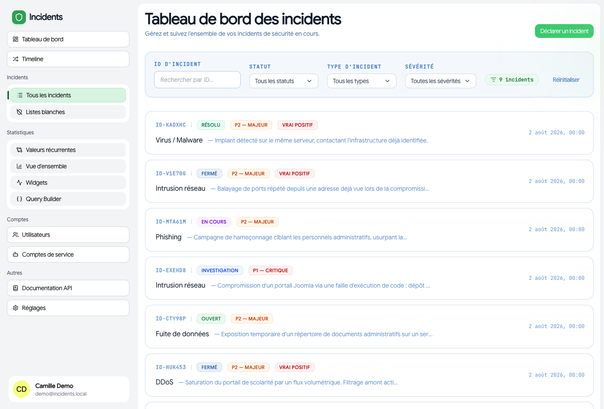
>
> 📷 **La liste des incidents.** Repérez la **barre de filtres** (type, statut, sévérité, période) et la **pastille de total** qui indique combien d'incidents correspondent aux filtres actifs — pratique pour vérifier qu'un filtre fait bien ce qu'on croit.

Sous les filtres, deux **raccourcis** répondent aux deux questions qu'on se pose en arrivant :

| Raccourci | Ce qu'il montre |
|---|---|
| **Incidents à traiter** | Ouvert, Investigation, En cours, Sous surveillance — tout ce qui n'est ni résolu ni clôturé |
| **En cours de traitement** | Investigation, En cours, Sous surveillance |

Un second clic retire le raccourci. Choisir un statut précis dans le menu *Statut* le remplace : les deux ensemble donneraient une liste qui ne répond à aucune des deux questions. Le compteur de total suit le raccourci.

### Prise en charge

En haut de la fiche, le **premier bouton de la barre d'actions** indique toujours qui suit l'incident : le **nom du pilote**, « **Vous pilotez** » si c'est vous, ou « **Sans pilote** » quand personne ne s'en occupe. Un clic ouvre les actions possibles :

- **« Je prends en charge »** (gestionnaires et admins) : vous devenez le pilote.
- **« Attribuer à quelqu'un d'autre… »** — réservé aux **admins**, y compris pour **réattribuer** un incident déjà pris en charge (absence, congés, rééquilibrage). Seuls les **gestionnaires et administrateurs** sont proposés : un lecteur ne pourrait pas agir sur l'incident dont il aurait la charge.
- **« Retirer la prise en charge »** : le pilote lui-même ou un admin remet l'incident à l'état non pris en charge.

Un **lecteur** voit le pilote mais n'a aucune action : l'information l'intéresse, la décision ne lui appartient pas.

Chaque action est inscrite à la chronologie, et le pilote désigné est notifié s'il n'est pas l'auteur de l'action. Quand un admin désigne quelqu'un d'autre, la chronologie retient **les deux noms** — qui a été désigné, et par qui.

> La prise en charge est **toujours explicite** : passer un incident en « En cours » ne désigne personne. C'est cette distinction qui permet de savoir qui relancer — et quand cesser de relancer.

### Détails, activité et chronologie
Sur la fiche d'un incident :
- **Détails** — les champs techniques du type, présentés par sections. Les métadonnées libres sont affichées en clair (les longues, comme un journal réseau, se **déplient au clic**).
- **Utilisateurs** — les personnes concernées (obligatoire pour phishing).
- **Artéfacts** — pièces jointes / fichiers liés à l'incident.
- **Activité & chronologie** — le fil des changements (création, changements de statut, commentaires, ajouts…).

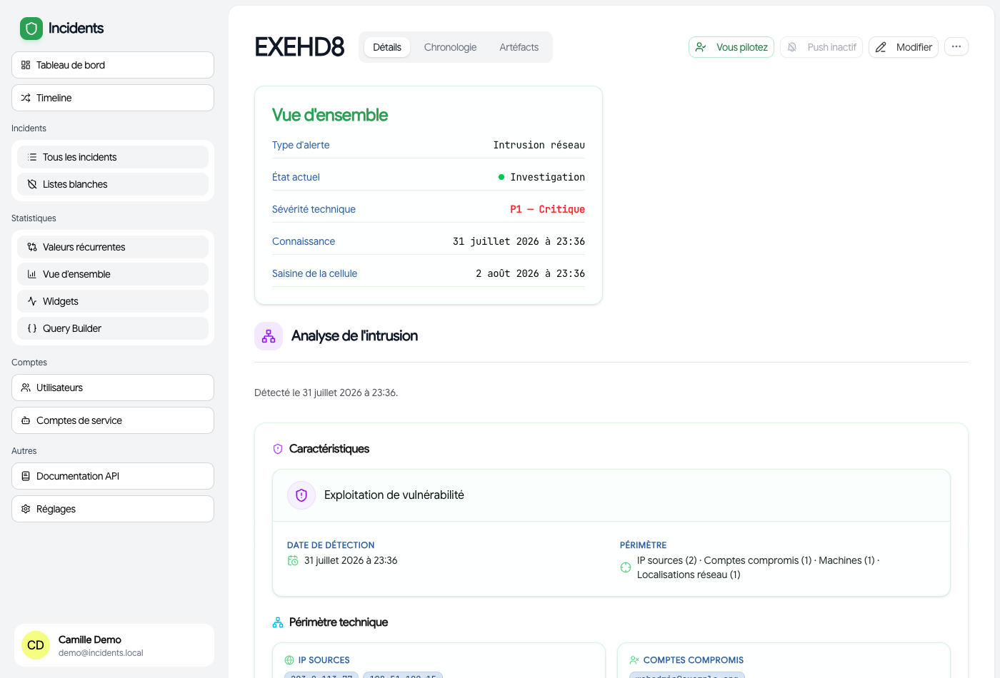
>
> 📷 **Onglet Détails.** Les champs techniques sont groupés par section, avec en tête une carte de synthèse (type, date de détection, périmètre). Les **informations complémentaires** s'affichent en clé/valeur ; une valeur longue (journal réseau d'un signalement de CERT, par exemple) se **déplie au clic**.

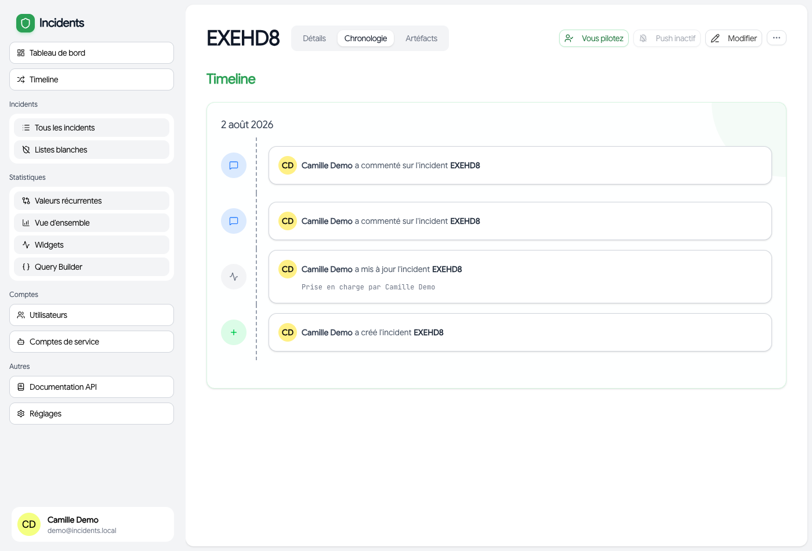
>
> 📷 **Activité & chronologie.** Chaque ligne est une action horodatée avec son auteur. C'est ici qu'on reconstitue *qui a fait quoi et quand* — et c'est le texte de ces lignes qui part en notification aux personnes qui suivent l'incident.

### Machines concernées
Sur l'onglet Détails, le champ **Machines concernées** cherche dans l'inventaire pendant que vous tapez et propose les correspondances. **La recherche n'est jamais obligatoire** : valider sans rien choisir enregistre ce que vous avez saisi — une machine absente de l'inventaire est parfaitement acceptable, elle est simplement marquée « hors inventaire ».

Une machine de l'inventaire arrive avec son groupe, son entité et son lieu, et un lien vers sa fiche. Celles du **groupe critique** portent un badge rouge : rien à savoir par cœur, c'est l'inventaire qui le dit.

L'import du SOC rattache les machines automatiquement, y compris celles qui ne sont que **citées dans le texte** du rapport — le prestataire ne déclare pas toujours l'actif. Ce rattachement est vérifiable et se retire d'un clic.

L'intérêt dépasse la fiche : c'est ce qui permet à la page **Valeurs récurrentes** de voir qu'une même machine revient d'un incident à l'autre. En texte libre, `SRV-01` et `srv-01` comptaient pour deux.

### Conduite à tenir
Cet onglet affiche la **checklist de la cellule** qui correspond à l'incident, telle qu'écrite dans le dépôt de documentation — rien n'y est reformulé ni engendré.

En tête, un **bandeau** résume ce qui presse : l'échéance la plus proche, les manques qui bloquent (pas de date de connaissance, pas de pilote) et les **premières cases non cochées**, dans l'ordre de la checklist — qui est déjà l'ordre du gain, vos fiches le disent. Ce bandeau est entièrement calculé : il s'affiche instantanément, même si l'assistance est éteinte.

Une **pastille sur l'onglet** signale une échéance dépassée ou à moins de six heures, sans avoir à ouvrir l'onglet. Au-delà, pas de pastille : une alerte permanente cesse d'être vue.

Slowpoke y ajoute ce que le texte ne peut pas savoir :

- **Les échéances réglementaires**, armées selon le niveau, conformément à la section 4 de la grille de classification : NIS2 systématique en P1 (24 h, 72 h et rapport à un mois), **à évaluer en P2**, **non en P3 et P4** sauf faisceau révélant une campagne. Le RGPD reste à évaluer dès qu'il peut y avoir des données personnelles, le signalement au CERT de rattachement dès qu'une alerte en vient.

  Chaque compteur se déclare **applicable** ou **non applicable** d'un clic, et *défaut* revient à la règle de la grille. La décision est enregistrée avec son auteur — ce qui compte autant que la décision le jour où il faut expliquer pourquoi un délai n'a pas été armé. Tant qu'un compteur « à évaluer » n'est pas tranché, le bandeau le réclame : il n'invente aucune échéance, mais ne laisse pas décider par oubli.

- Les échéances comptées depuis la date de **connaissance** — celle de l'établissement, pas celle de la cellule. NIS2 24 h et 72 h, RGPD 72 h, CERT 72 h. Slowpoke rappelle la condition de chacune ; il ne décide pas qu'un délai s'applique. Sans date de connaissance, aucun compteur ne court, et l'onglet le dit.
- **L'avancement**, partagé : les cases cochées appartiennent à l'incident, pas à la personne. Deux analystes sur le même incident voient le même état.

La procédure retenue est déduite du type et de la gravité — un hameçonnage touchant plusieurs comptes bascule sur la fiche « campagne », un compte en P1 ou P2 sur « compte critique ». Ce choix est **affiché** et se change d'un clic : Slowpoke ne sait pas si un compte est critique au sens de l'annexe E, seul un analyste le sait.

La fiche complète, qui porte le raisonnement là où la checklist porte les gestes, est dépliable en bas de l'onglet.

#### Assistance (si configurée)
Quatre demandes, dans l'onglet, toutes facultatives :

- **Situer l'avancement** — le modèle lit l'incident et propose, case par case, ce qui semble déjà fait. La proposition s'affiche à côté de la case avec sa justification ; **c'est vous qui cochez**.
- **Suggérer la procédure** — utile sur les incidents de type « autre », où le type ne suffit pas à orienter. Un bouton applique la suggestion.
- **Résumer** — trois phrases sur un rapport long, typiquement un ticket du SOC.
- **Relever les indicateurs** — extrait les IP, domaines, URL, empreintes et comptes cités dans le texte. À reporter à la main après vérification.

Un **fil de conversation** complète ces quatre demandes, pour ce qu'elles ne couvrent pas : une question sur la procédure, une comparaison entre deux fiches, un point à éclaircir. Deux fils par incident — **partagé**, visible de toute la cellule, pour que celui qui reprend voie ce qui a déjà été demandé ; et **le vôtre**, pour vos questions tâtonnantes.

Ces conversations **n'apparaissent pas dans la chronologie** : le journal d'un incident est une pièce de dossier, une discussion avec un modèle n'y a pas sa place. Le modèle répond à partir de l'incident et de sa procédure ; il ne juge ni la gravité, ni l'applicabilité d'un délai. Seuls les cinq derniers échanges lui sont renvoyés, pour que la procédure reste dans son champ de vision.

Rien n'est appliqué automatiquement et rien n'est écrit dans les champs de l'incident. Les propositions d'un modèle local restent à vérifier : il ne connaît que ce que l'incident contient.

### Enquête
Les cases de la checklist qui peuvent être **outillées** le sont, et cet onglet les regroupe : une question à la fois, avec ce que Slowpoke sait chercher à votre place. La checklist complète reste dans *Conduite à tenir*.

Chaque étape dit **pourquoi elle existe**, **où elle cherche**, et aide à **lire le résultat** — ces trois textes viennent du dépôt de procédures, pas du code. Un bouton lance la recherche, toujours **en lecture seule**, et le résultat est enregistré avec la **version exacte de la requête** employée ce jour-là.

Vous rendez ensuite un **verdict** : *Rien trouvé*, *Trouvé*, ou *Impossible à vérifier*. Le dernier **exige un motif** : sans lui, une étape sans source se lirait comme vérifiée. Les verdicts s'inscrivent dans la chronologie de l'incident.

Une même case peut porter **plusieurs recherches** — par exemple, pour les journaux d'authentification : ce que la fiche contient déjà, puis les journaux de messagerie, de portail d'authentification et d'annuaire lus dans les archives de Wazuh. Chacune garde son propre verdict.

⚠️ **Zéro résultat n'est pas « rien ».** Une recherche qui ne trouve rien l'accompagne de ce qui empêche de conclure : source non configurée, rétention dépassée, remontée interrompue, plafond de lignes atteint. Une étape dont la source n'a pas répondu se range en « impossible à vérifier », jamais en « rien trouvé ».

Les requêtes disponibles viennent de la **bibliothèque du dépôt de procédures** (`_requetes/`), relue toutes les six heures. Slowpoke n'exécute **que** les identifiants qu'il connaît : une requête décrite dans le dépôt mais pas encore outillée le dit au lieu de prétendre chercher.

### Phishing par utilisateur
Pour un incident de phishing, chaque **utilisateur concerné** porte :
- ses **identités usurpées** (adresses d'envoi / de réponse) ;
- ses **logs d'activité** : connexions (IP, pays, plage horaire) et **actions** (messages envoyés / supprimés, contacts ajoutés, identité modifiée, ou action libre).

---

## 3 bis. Listes blanches

Marquer un incident « bénin » dit qu'une détection portait sur une activité légitime. Cela ne dit pas **ce qui a été mis en liste blanche**, ni **jusqu'à quand** — c'est l'objet de cette page (barre latérale → **Listes blanches**).

### Déclarer une liste blanche

Depuis la **fiche de l'incident** qui la motive : menu **⋯** → **« Déclarer une liste blanche »**.

Le formulaire propose les critères **de l'outil choisi**, et ils se **combinent** — en pratique on exclut un chemin, une empreinte ou une règle, presque toujours restreint à une machine :

| Outil | Critères proposés |
|---|---|
| **HarfangLab** | chemin · empreinte SHA-256 · processus · processus parent · machine ou groupe |
| **Wazuh** | ID de règle · agent · chemin surveillé · champ + valeur du décodeur |
| **Pare-feu** | source · destination · port · protocole · sens |
| **Autre** | nom de l'outil + description + machine |

Un **aperçu** montre en direct ce qui sera enregistré. Au moins un critère est exigé.

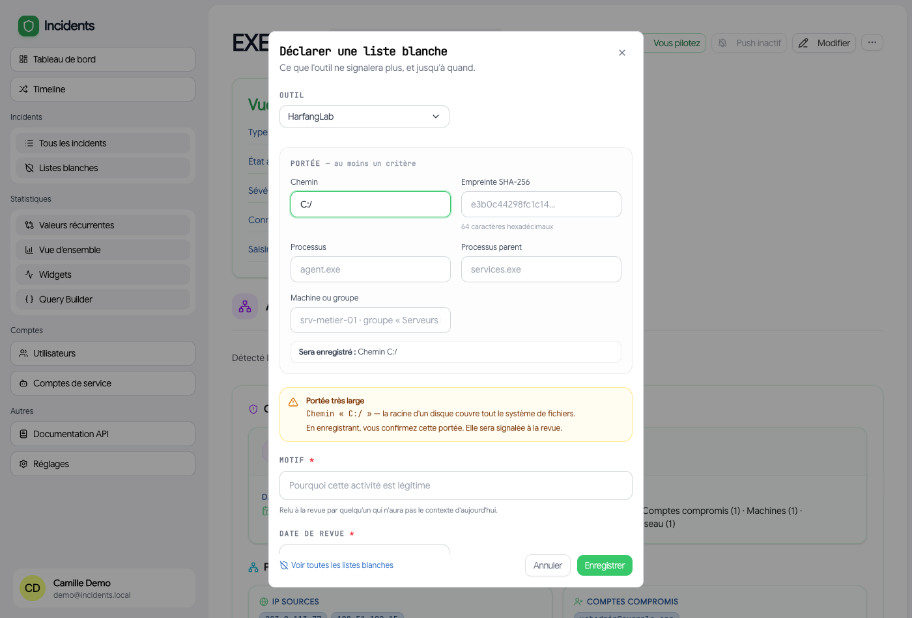
>
> 📷 **Déclarer une liste blanche.** Les critères proposés sont ceux de l'outil sélectionné et se combinent. En bas, l'encart **« Sera enregistré »** montre le libellé qui sera conservé, et l'avertissement jaune se déclenche ici parce que `C:/` couvre tout le disque.

> ⚠️ **Portée trop large** — si un critère couvre tout (`C:\`, `*`, `0.0.0.0/0`, une plage plus large qu'un /16), un avertissement explique pourquoi et **exige une confirmation**. L'exclusion reste possible, mais elle est signalée comme telle à la revue. Une exclusion sur la racine d'un disque n'est pas une exclusion, c'est un trou.

Chaque exclusion porte aussi :

| Champ | Pourquoi |
|---|---|
| **Motif** | **obligatoire** — relu à la revue par quelqu'un qui n'aura pas le contexte d'aujourd'hui |
| **Date de revue** | **obligatoire** — pas de liste blanche sans échéance (trois mois par défaut) |

La page **Listes blanches** présente une fiche par exclusion : l'outil, la portée enregistrée, le motif, la date de revue et l'incident d'origine. Un filtre en tête permet de voir les **actives**, les **révoquées** ou **toutes**.

Quand une date de revue est dépassée, un **bandeau d'alerte** l'annonce en tête de page et la fiche concernée est surlignée : l'exclusion est toujours active alors que personne ne l'a reconfirmée. Deux issues — **reporter** l'échéance après examen, ou **révoquer** l'exclusion.

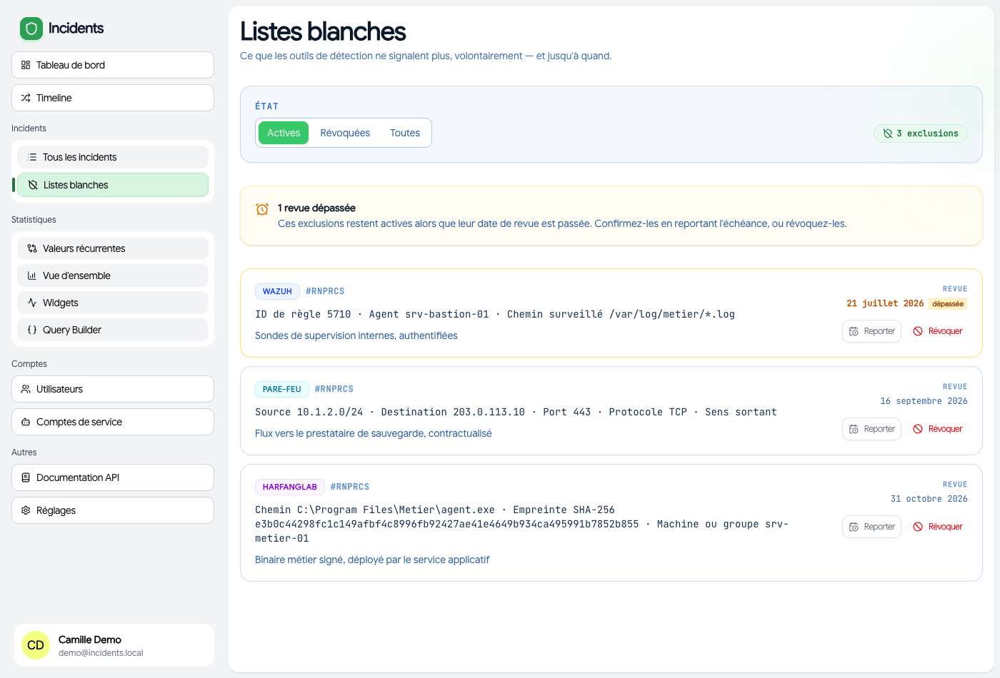
>
> 📷 **La page Listes blanches.** Le bandeau jaune compte les **revues dépassées** et la fiche concernée est surlignée. Les exclusions sont triées par date de revue croissante : ce qui expire en premier remonte en tête, c'est l'ordre dans lequel on veut les traiter.

Une exclusion révoquée n'est pas supprimée : savoir qu'un angle mort a existé éclaire un incident ultérieur sur le même périmètre.

### L'échéance vous est rappelée

Jusqu'au 6 octobre 2026, la date de revue était obligatoire mais **rien ne la regardait** : il fallait penser à ouvrir la page. Désormais, **sept jours avant** l'échéance puis **chaque semaine tant qu'elle est dépassée** :

- une **notification** (à cocher une fois dans Réglages → *Revue des listes blanches*), groupée : « 3 listes blanches à revoir — 1 en retard, 2 dans les 7 jours » ;
- un **webhook** par échéance, pour qui veut en faire quelque chose dans son orchestrateur.

Reporter une échéance remet le rappel à zéro : sinon, reporter aurait valu « ne plus m'en parler ».

### Règles posées hors incident

Même page, section à part. Ce sont les règles de l'EDR consignées **sans incident** — besoin métier, exploitation, exception technique. Elles portent les mêmes exigences qu'une exclusion : un motif, une échéance, et le même rappel. Deux actions : **Reporter** après examen, ou **Lever** avec son motif (règle retirée de l'outil, besoin disparu). La ligne reste consultable une fois levée.

Quand une de ces règles reçoit plus tard une **exclusion** née d'un incident, c'est l'échéance de l'exclusion qui fait autorité : la revue isolée passe en « remplacée » et cite l'exclusion qui a pris le relais. Une règle ne porte jamais deux dates.

---

### Rapprochement avec l'EDR
En tête de la page **Listes blanches**, si l'EDR est configuré. Il montre ce qui existe d'un côté sans exister de l'autre : une règle posée dans la console sans être consignée, ou une exclusion consignée dont la règle a disparu.

Slowpoke **ne crée jamais l'exclusion tout seul** : elle exige un motif et une date de revue, qui ne peuvent venir que de vous. La vue signale, vous décidez — mais vous décidez **depuis la vue**.

Les **règles de l'EDR non consignées** portent un bouton **Consigner**, qui ouvre une fenêtre à deux issues :

- **Motivée par un incident** — la règle devient une **exclusion** rattachée à cet incident, et apparaît dans sa chronologie. Seuls les incidents encore à traiter sont proposés ; pour un dossier clos, passez par sa fiche.
- **Posée hors incident** — besoin métier, exploitation, exception technique : elle reçoit une **revue programmée**, sans incident. Elle apparaît alors dans la section *Règles posées hors incident* de la page, et son échéance est rappelée comme celle d'une exclusion.

Dans les deux cas, un **motif** et une **échéance** sont exigés. Une règle déjà décidée affiche son échéance et sort du compteur d'écarts ; le bouton devient *Modifier*. Les règles fournies par l'éditeur ne sont pas listées : elles sont des centaines et ne relèvent d'aucune décision de la cellule.

Pour rattacher une exclusion à sa règle, *chercher la règle* propose des correspondances d'après la portée ; quand elle ne trouve rien, un champ de **recherche libre** permet de la choisir soi-même. Le rattachement fonctionne aussi dans l'autre sens, depuis la règle constatée.

Un quatrième écart s'affiche **même sans EDR configuré** : les incidents clos en « légitime » sans aucune exclusion enregistrée. Classer un incident légitime, c'est décider de ne plus voir quelque chose — cette décision doit être consignée.

Sur la date de revue, à la création : **un an par défaut**, conformément à la règle de la cellule, ramené à **trois mois** dès qu'une portée large est détectée. Quatre raccourcis sont proposés — un « le temps de vérifier » mérite un mois, pas un an.

La date de la dernière lecture réussie accompagne toujours le résultat : une liste vide doit dire si tout va bien ou si la lecture a échoué.

## 4. Notifications

Slowpoke envoie des **notifications Web Push**, **multi-navigateurs** : un même compte peut recevoir sur tous ses appareils. Deux réglages :

1. **Activer sur ce navigateur** (Réglages) — indispensable en premier. Chaque appareil/navigateur s'active séparément. Nécessite un navigateur compatible et l'autorisation des notifications.
2. **« Nouveaux incidents »** (Réglages, une fois le push activé) — vous êtes notifié **à chaque incident créé**.
3. **« Revue des listes blanches »** (Réglages) — sept jours avant une date de revue, puis tant qu'elle est dépassée. Une notification groupée par passage, exclusions et règles posées hors incident confondues.
4. **« Alertes graves »** (Réglages) — à l'arrivée d'une alerte **neuve** au-dessus du niveau réglé (P2 par défaut). Jamais sur une occurrence, jamais sur une série faite taire : notifier chaque alerte, c'est faire couper les notifications au bout d'une journée.
5. **Suivre un incident** (bouton *Suivre l'incident* sur une fiche) — vous êtes notifié à **chaque modification de cet incident précis**. Le bouton est inactif tant que le push n'est pas activé sur le navigateur.

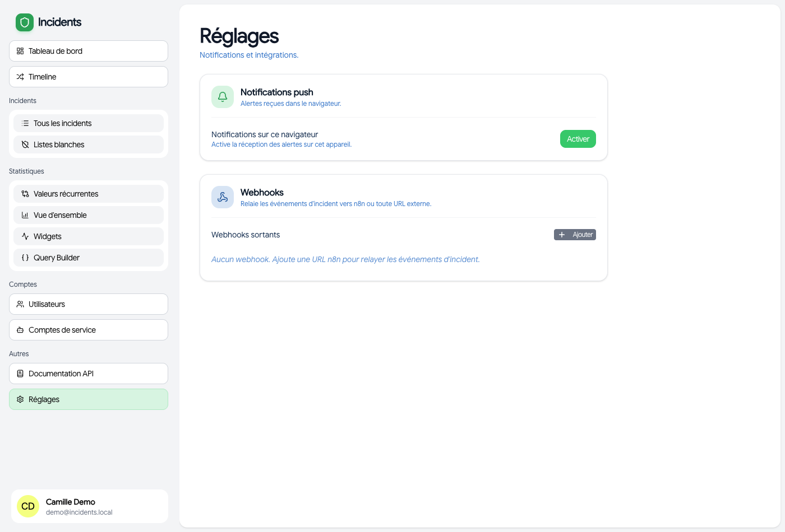
>
> 📷 **Réglages.** L'interrupteur du haut vaut **pour ce navigateur uniquement** : à refaire sur chaque appareil. La case « Nouveaux incidents » n'apparaît qu'une fois le push activé — si vous ne la voyez pas, c'est l'étape d'avant qui manque.

Dans tous les cas, **vous n'êtes jamais notifié de votre propre action**. Titre de la notification = type d'incident + date de détection ; corps = le message du changement (identique à la chronologie). Cliquer ouvre la fiche de l'incident.

---

## 5. Statistiques

Section **« Statistiques »** de la barre latérale, trois entrées.

### Vue d'ensemble (`/stats`)
Accessible à tous les rôles en lecture. Un **sélecteur de période** en haut (30 derniers jours par défaut) filtre l'ensemble. On y trouve :
- des **indicateurs** (KPI) : *Ce mois-ci* (avec évolution ▲/▼ vs le mois précédent), *En traitement* (incidents en investigation + en traitement, « sur N ouverts »), *Critiques* (sévérité critique encore actifs) ;
- une **frise** des incidents par jour ;
- la **répartition par type** et **par sévérité** ;
- le **profil des utilisateurs** concernés (par affiliation) ;
- le **classement des composantes** impactées (top 10).

> À noter : les KPI *Ce mois-ci* / *En traitement* / *Critiques* portent sur des fenêtres fixes (mois en cours) et **ne suivent pas** le sélecteur de période, contrairement aux graphiques.

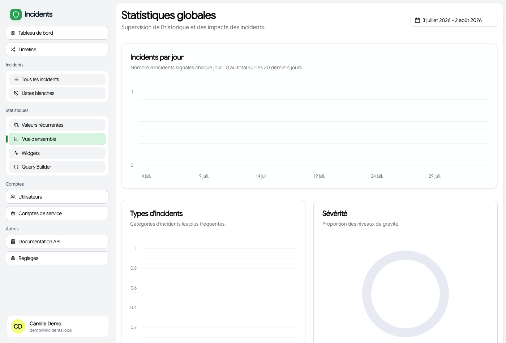
>
> 📷 **Vue d'ensemble.** Le sélecteur de période en haut agit sur les **graphiques** ; les trois KPI, eux, restent sur le mois en cours (c'est voulu, mais déroutant si on l'ignore). Le KPI *En traitement* se lit « X en traitement **sur N ouverts** ».

### Widgets (`/stats/widgets`)
Un **tableau de bord personnalisable** fait de widgets créés par les administrateurs. Chacun affiche le résultat d'une requête SQL enregistrée, rendu en graphique (**barres**, **camembert** ou **zone chronologique**).

Pour un **admin**, en mode édition (*Modifier la disposition*) :
- **réordonner** les widgets par glisser-déposer ;
- régler la **largeur** de chaque widget (1 à 4 colonnes) ;
- **activer/désactiver** l'affichage d'un widget ;
- **enregistrer la disposition**.

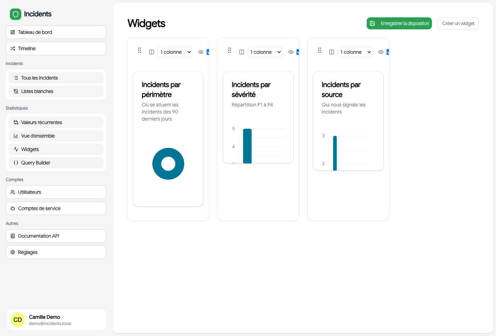
>
> 📷 **Widgets, en mode « Modifier la disposition ».** Chaque widget montre alors sa poignée de déplacement, son sélecteur de largeur (1 à 4 colonnes) et sa case de visibilité. Les changements ne sont pris en compte qu'après **Enregistrer la disposition**.

### Valeurs récurrentes (`/stats/correlation`)

Accessible à **tous les rôles en lecture**. Elle répond à une question qu'aucun incident pris isolément ne permet de poser : **qu'est-ce qui revient ?**

Machines, IOC, IP sources, serveurs C2 et comptes compromis apparaissant dans **au moins N incidents distincts** sur une fenêtre glissante (30 jours et 3 incidents par défaut, tous deux réglables). Chaque ligne renvoie vers les incidents concernés.

> Le comptage porte sur les **incidents distincts** : une même IP citée trois fois dans un seul incident ne constitue pas une récurrence.

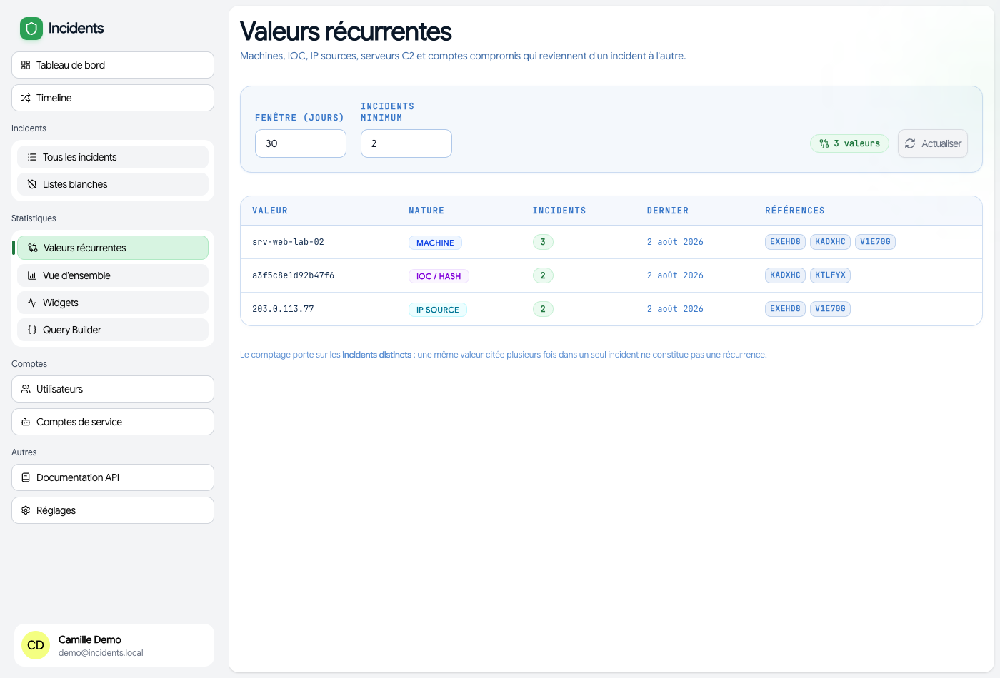
>
> 📷 **Valeurs récurrentes.** Ici le seuil a été abaissé à 2 incidents. La machine `srv-web-lab-02` revient dans trois incidents distincts : c'est le genre de recoupement qu'aucune fiche prise isolément ne laisse voir. Les pastilles de droite mènent directement aux incidents concernés.

### Query builder (`/stats/query-builder`)
Réservé aux **admins**. Une **console SQL** pour interroger la base directement.
- Vous écrivez du **SQL** dans l'éditeur (par défaut `SELECT * FROM incident`), puis **Exécuter**.
- Le résultat s'affiche en JSON et s'**exporte** en JSON / CSV / Texte.
- L'**historique** des 10 dernières requêtes est conservé dans votre navigateur (rechargeable).

**Garde-fous** (important) :
- L'accès se fait par un compte base **en lecture seule** : seules des lectures (`SELECT`) sur les tables d'incidents sont possibles — aucune écriture, aucune table d'authentification.
- Certaines constructions sont **bloquées** même en lecture : les **commentaires SQL** (`--`, `/* */`) et les **CTE** (`WITH … AS`). Écrivez des requêtes « à plat » (sous-requêtes plutôt que CTE).
- **Deux garde-fous** : au-delà de **5 000 lignes**, le résultat est tronqué et l'indique explicitement (« Résultat tronqué… ») ; au-delà de **10 secondes**, la requête est interrompue et vous invite à restreindre la période. Les deux seuils sont réglables par l'exploitant.

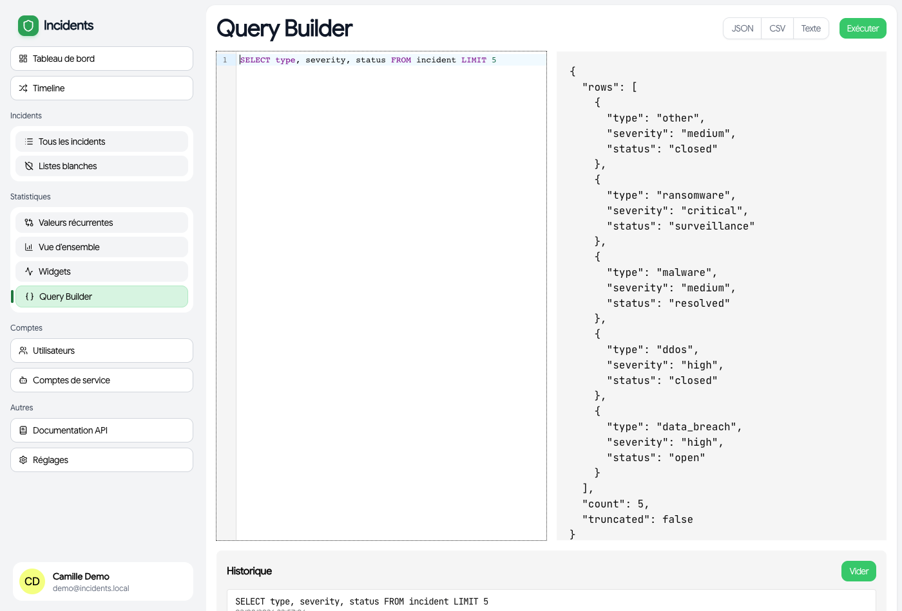
>
> 📷 **Query builder.** L'éditeur SQL en haut, le résultat JSON en dessous, et les boutons d'export (JSON / CSV / Texte) qui n'apparaissent qu'une fois une requête exécutée. L'historique des 10 dernières requêtes est stocké **dans votre navigateur** : il ne suit pas d'un poste à l'autre.

### Créer un widget (admins)
Depuis la page *Widgets*, bouton **« Créer un widget »** (`/stats/create`) :
1. **Titre**, description, **type de graphique** (barres / camembert / zone).
2. **Requête SQL** (mêmes règles que le query builder) — bouton *Tester la requête* pour prévisualiser les lignes.
3. **Correspondance des axes** : quelle colonne sert de **catégorie** (axe X / nom) et quelle colonne sert de **valeur** (axe Y / compte).
4. **Couleurs & libellés** : associer chaque valeur brute à un libellé lisible et une couleur.
5. **Transformateur** (optionnel) : un petit script pour remodeler les lignes avant affichage.
6. Un **aperçu en direct** accompagne la saisie ; **Enregistrer** ajoute le widget au tableau de bord.

> Il n'existe pas (encore) de page d'**édition** d'un widget : pour changer la requête ou la configuration d'un widget existant, il faut le **supprimer et le recréer** (seules la disposition et la visibilité sont modifiables après coup).

---

## 6. Import automatique & comptes de service

Les incidents peuvent aussi être créés **automatiquement** par une machine via l'**API**, à l'aide d'un **compte de service** : signalement reçu par courriel, webhook d'un service interne, alerte d'un CERT… Tout orchestrateur capable d'un appel HTTP (n8n, Node-RED, un script `cron`) convient — c'est l'API qui fait le travail, pas l'outil.

- Un **admin** crée un compte de service et une **clé** (préfixe `sk_…`) dans *Comptes → Comptes de service*.
- **Lire la clé** : elle est floutée par défaut. Passez la souris dessus, ou appuyez sur le bouton **œil** (indispensable sur mobile et tablette, où il n'y a pas de survol). **Cliquez sur la clé** pour la copier.
- La clé s'utilise en en-tête HTTP : `x-service-key: sk_…` **ou** `Authorization: Bearer sk_…`.
- Les **scopes** choisis à la création sont appliqués : `Lecture` autorise les consultations (`GET`), `Écriture` la création et la modification, `Suppression` les suppressions, `Admin` tout. Une clé qui sort de son périmètre reçoit une erreur `403`. Donnez le minimum nécessaire — un flux d'import n'a besoin que d'**Écriture**.
- ⚠️ Une clé reste un secret sensible : durée de vie limitée et rotation régulière. La **suppression d'un incident** n'est jamais ouverte aux comptes de service.

> **Comptes → Utilisateurs** (admin). C'est ici qu'on **attribue les rôles**. Un nouveau venu apparaît en `user` sans accès : c'est le geste à faire pour lui ouvrir l'application. Un admin ne peut pas modifier son propre rôle (garde-fou anti-verrouillage).

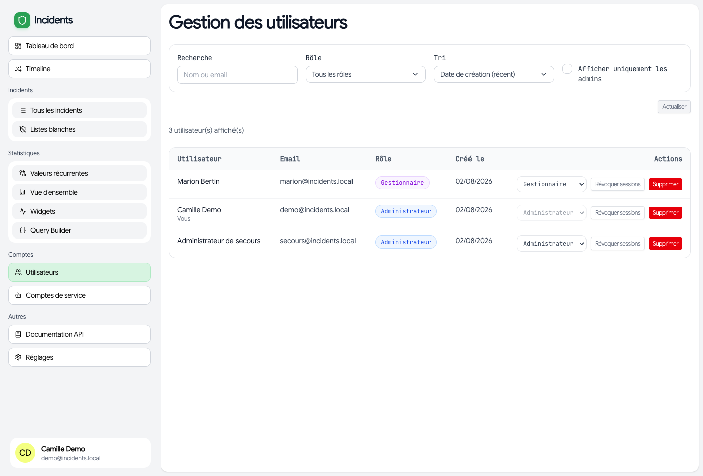
>
> 📷 **Comptes → Utilisateurs** (admin). Le rôle se change directement dans la liste. C'est la seule page qui débloque un compte resté en `user`, et le seul endroit où l'on peut retirer un accès.

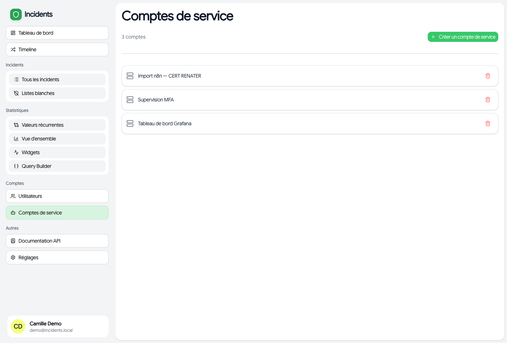
>
> 📷 **Comptes de service** (admin). Chaque clé est floutée : on la révèle au survol ou avec le bouton **œil** (à gauche de la corbeille), et un clic sur la clé la copie. ⚠️ **Caviardez intégralement la clé avant toute capture** — selon son scope, elle peut écrire dans l'application.

La forme exacte des charges utiles, type d'incident par type d'incident, est dans [`Documentation.md`](Documentation.md#automatiser-la-création-dincidents).

---

## 7. Où trouver quoi

| Je veux… | Aller dans |
|----------|-----------|
| Voir l'activité récente et les KPI | **Tableau de bord** (accueil) |
| Consulter / créer un incident | **Incidents** |
| Trier ce qui vient de la détection | **Alertes** |
| Retenir un fait d'infrastructure, pour qu'il serve au suivant | Fiche d'une alerte → **Ce que la cellule sait** |
| Voir ce qui reste à traiter | **Incidents** → raccourci *Incidents à traiter* |
| Dérouler la procédure, trancher les échéances | Fiche de l'incident → **Conduite à tenir** |
| Lancer les recherches outillées d'une case | Fiche de l'incident → **Enquête** |
| Savoir si une IP, un domaine ou un compte est déjà connu | **Chercher un indicateur** |
| Voir les angles morts volontaires et leurs échéances | **Listes blanches** |
| Voir les graphiques | **Statistiques → Vue d'ensemble** |
| Un tableau de bord sur mesure | **Statistiques → Widgets** |
| Interroger la base en SQL (admin) | **Statistiques → Query builder** |
| Activer mes notifications, gérer les webhooks | **Réglages** |
| Attribuer des rôles, gérer les comptes de service (admin) | **Comptes** |
